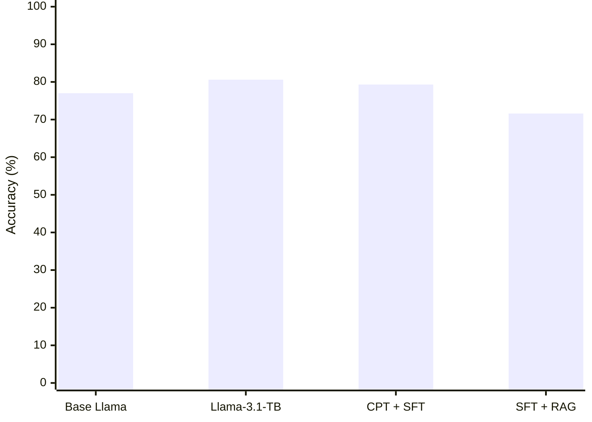
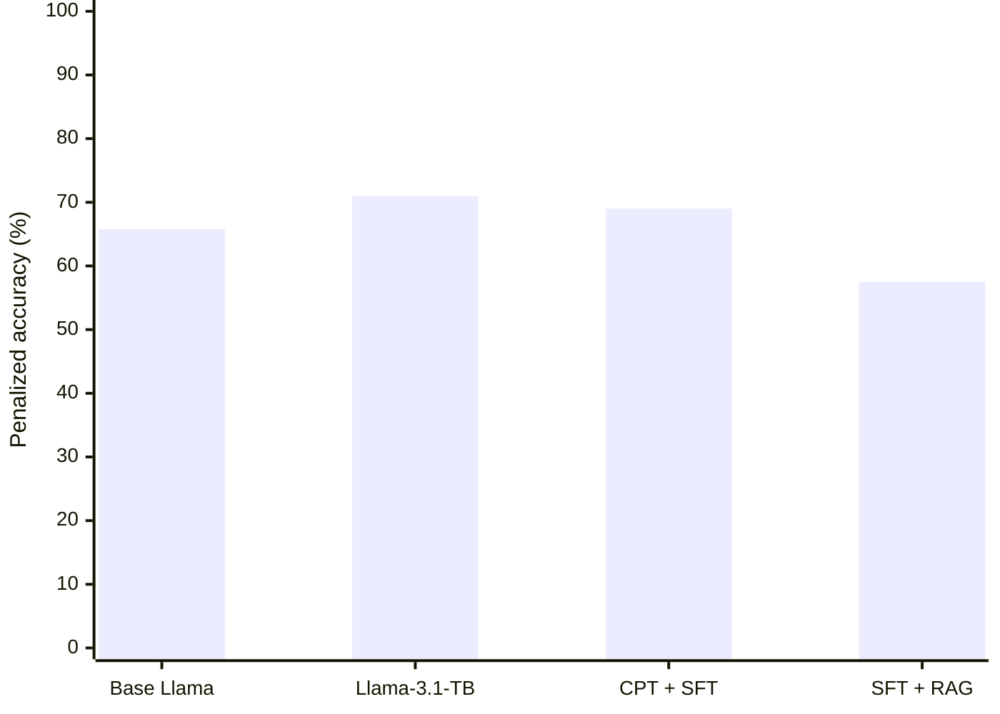

### Model performance

#### Answer accuracy (%)

#### Penalized accuracy (%)

**Model labels:**
- **Base Llama:** Base Llama-3.1-8B
- **Llama-3.1-TB:** Fine-tuned TB-specialized model
- **CPT + SFT:** Continued pretraining + supervised fine-tuning
- **SFT + RAG:** Supervised fine-tuning + retrieval-augmented generation
