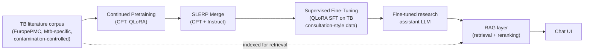

# TB Research Assistant

A domain-specific LLM research assistant for tuberculosis (TB) research. The goal: a model that
can help TB researchers interpret experimental results,
critique methodology, prioritize targets, and generate hypotheses, grounded in real TB/*Mycobacterium
tuberculosis* literature rather than general biomedical knowledge.

This is a curated showcase of the project for people outside the lab. The full research
repo (every experiment, every SLURM script, every intermediate result) lives at
[sedak326/tuberculosis_agent](https://github.com/sedak326/tuberculosis_agent).

## Try it

<!-- Live demo link: ask me and I'll have it running within a few minutes - it runs on a
     shared university GPU cluster, not kept on 24/7, so I spin it up on request rather than
     leave a link here that silently goes stale. -->
<!-- TODO: record a short demo (asking it a factual question, a methodology critique, and a
     hypothesis-generation prompt) and add it here:  -->

Want to try the live model? Reach out and I'll send you a link.

## The pipeline

1. **Corpus construction** — TB/Mtb-specific research literature fetched from EuropePMC, restricted
   to papers that genuinely discuss TB in the title/abstract. Contamination-controlled: built only
   from papers published after the base model's pretraining cutoff, so continued pretraining can't
   re-expose the model to memorized text, and the held-out evaluation set is guaranteed unseen.
2. **Continued pretraining (CPT)** — further pretraining on the TB corpus to inject domain
   knowledge. Several CPT recipes were compared on the same corpus, including replications of two
   published domain-adaptation setups (Doll et al. 2026's DeFineMed, Labrak et al. 2024's BioMistral).
3. **Model merging (SLERP)** — CPT on raw text degrades instruction-following. SLERP merging
   between the CPT checkpoint and the original Instruct model recovers most of that ability while
   keeping the domain knowledge gained during CPT.
4. **Supervised fine-tuning (QLoRA SFT)** — fine-tuning on TB-specific instruction data
   (consultation-style Q&A, methodology critique, hypothesis generation, result interpretation)
   to turn the knowledge-adapted model into something that follows a research-assistant interaction
   style.
5. **Retrieval-augmented generation (RAG)** — retrieves relevant passages from the TB corpus at
   query time instead of relying purely on parametric knowledge. Three retrieval backends were
   built and compared head-to-head.

## Key finding: domain knowledge and reasoning are separate levers

Across every domain-adaptation method tested — continued pretraining, supervised fine-tuning, and
retrieval-augmentation — accuracy gains concentrated in knowledge-recall-type questions, while
reasoning/analysis-type questions stayed comparatively flat. RAG showed the mirror image: retrieved
context sometimes *helped* recall-type questions but *hurt* accuracy on reasoning-heavy ones,
consistent with retrieved context diluting the actual reasoning task rather than aiding it.

The suggested takeaway: **injecting domain knowledge (via pretraining or retrieval) is not the
same lever as improving reasoning ability** — a model can get measurably better at TB facts without
getting any better at reasoning over them.

This held up as a consistent trend across independent evaluation conditions. To check how much of
it survives rigorous statistical scrutiny — important with ~90 comparisons run against the same
eval set — a full significance-testing pipeline was built: paired t-tests, an exact McNemar test as
a robustness check, paper-level cluster-bootstrap confidence intervals, and Bonferroni/Holm/
Benjamini-Hochberg correction for multiple comparisons under several reasonable definitions of the
comparison "family." Being upfront about which individual results survive correction and which
don't, rather than reporting only the uncorrected p-values, was a deliberate choice.

## What's in `core/`

A representative sample from each pipeline stage (the full set of experiment scripts, SLURM job
configs, and ablations live in the [full repo](https://github.com/sedak326/tuberculosis_agent)):

| File | Stage |
|---|---|
| `train_cpt.py` | Continued pretraining (QLoRA) |
| `train_sft.py` | Supervised fine-tuning (QLoRA) |
| `merge_configs/v5_cpt_instruct_slerp.yaml` | SLERP merge recipe |
| `rag_pipeline.py` | Retrieval + generation pipeline |
| `chat_ui.py` | Self-hosted chat UI (Flask) serving the fine-tuned model |
| `evaluate_emcqa.py` | Evaluation: inference over the held-out MCQ set |
| `generate_mcq.py` | Builds the held-out multiple-choice evaluation set |

## Stack

Llama-3.1-8B-Instruct / Qwen2.5-7B-Instruct base models · QLoRA (PEFT + bitsandbytes) · `mergekit`
(SLERP) · LangChain + Chroma (RAG) · sentence-transformers / PubMedBERT embeddings · Flask ·
GPT-4o as an automated judge for explanation quality · SLURM for cluster scheduling.

## Author

**Seda Kavlak** — Jinich Lab, UC San Diego. Advised by Prof. Jinich.
