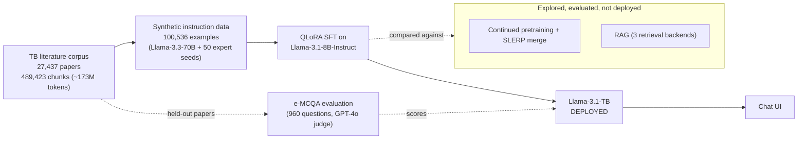

# Llama-3.1-TB: A Research Assistant for Tuberculosis Science

**A fine-tuned, self-hosted 8B language model that helps TB researchers interpret experimental results, critique methodology, and generate testable hypotheses.**

Built on `Llama-3.1-8B-Instruct` with QLoRA, trained on 100K+ instruction examples grounded in 27,000+ TB research papers, and evaluated head-to-head against continued pre-training, model merging, and retrieval-augmented generation (RAG). Runs on a single GPU with no external LLM API in the loop.

This is a curated showcase for people outside the lab. The full research repo (every experiment, SLURM script, and intermediate result) is at [sedak326/tuberculosis_agent](https://github.com/sedak326/tuberculosis_agent). The full write-up is my master's thesis: [Thesis PDF](#) *(add link)*.

## Try it

<!-- Live demo link: ask me and I'll have it running within a few minutes - it runs on a
     shared university GPU cluster, not kept on 24/7, so I spin it up on request rather than
     leave a link here that silently goes stale. -->
<!-- TODO: record a short demo (asking it a factual question, a methodology critique, and a
     hypothesis-generation prompt) and add it here:  -->

The model runs on a shared university GPU cluster, so it isn't up 24/7. Reach out and I'll spin it up and send you a link.

## What it does

The assistant is built to sit next to a TB researcher and help with scientific reasoning, not only factual lookup:

- **Interprets results:** what does this experimental outcome actually imply?
- **Critiques methodology:** where might this approach be weak, before more time is invested?
- **Generates hypotheses:** what is a plausible, testable explanation for an observation?
- **Guides literature thinking:** points toward the right conceptual framing and relevant research directions.

> **Q: What is ESAT-6?**
>
> ESAT-6, or Early Secreted Antigen 6, is a protein secreted by *Mycobacterium tuberculosis*, a
> bacterium that causes tuberculosis. It is a key virulence factor, meaning it plays a crucial
> role in the pathogenesis of TB. ESAT-6 is involved in the evasion of the host immune response,
> allowing the bacteria to survive and replicate within the host. It is secreted by the ESX-1
> secretion system, a type VII secretion system essential for the virulence of *M. tuberculosis*...

It is served through a self-hosted Flask chat app (`chat_ui.py`).

## Why this is needed

Tuberculosis is the deadliest infectious disease in the world. *M. tuberculosis* biology is complex, and the knowledge needed to understand it is spread across tens of thousands of papers, databases, and subfields.

> *An estimated 10.8 million people developed TB in 2023, and 1.25 million died.* (Lee et al., 2025, summarizing the WHO Global Tuberculosis Report 2024)

> *263,234 TB articles were published between 1849 and 2020, and output has kept rising every year.* (Ekenoğlu Merdan & Etiz, 2022; Kshtriya et al., 2026)

> *TB research spans epidemiology, basic science, diagnostics, treatment, vaccines, and public health, across many countries.* (Nafade et al., 2018)

The bottleneck is no longer access to papers. It is finding, weighing, and combining what is in them:

> *Evidence-synthesis studies grew roughly sixfold from 2008 to 2020, and by 2020 researchers had to screen about twice as many records to find the relevant ones.* (Gusenbauer, 2021, whose title argues that "just google it" is no longer enough)

> *Synthesizing the scientific literature is central to identifying new directions, refining methods, and supporting evidence-based decisions.* (Asai et al., *Nature*, 2026)

Mtb-specific knowledge is also fragmented across resources, from transposon-sequencing databases to curated resistance catalogs and knowledge graphs (Jinich et al., 2025; Dai et al., 2019; Lose et al., 2020; Reddy et al., 2009).

**The problem this project addresses:** a TB researcher should be able to ask a scientific question in natural language and get a useful, expert-style answer, from a model small enough to run on lab hardware and trained on the literature they actually work with.

## How I built it

1. **Corpus.** Full-text articles from PubMed Central and Europe PMC, plus additional collected sources, deduplicated to 27,437 documents. Documents are split along native section structure (JATS/XML tags, or typographic cues for PDFs) into 489,423 chunks of at most 4,000 characters, each with source metadata.
2. **Instruction data.** Members of the Jinich Lab wrote 50 seed examples (a persona, a realistic researcher question, and an expert-style answer). Using these as few-shot demonstrations, Llama-3.3-70B-Instruct generated 100,536 instruction/response pairs grounded in sampled literature chunks, following the BioInstruct approach.
3. **Fine-tuning.** QLoRA (4-bit NF4, LoRA rank 64, alpha 128, 2 epochs, response-only loss) on Llama-3.1-8B-Instruct. I compared my configuration against two published recipes (Labrak et al. 2024; Hashemi et al. 2025).
4. **Alternatives I tested.** Continued pre-training on the full corpus (replicating Doll et al. 2026 and Labrak et al. 2024, plus a custom recipe) with SLERP merging, and three RAG pipelines (a custom one, one replicating Hashemi et al., and a cross-encoder reranking pipeline after Bal & Puhan 2026).
5. **Evaluation.** An explanation-based multiple-choice benchmark (e-MCQA): 960 questions generated from 200 held-out papers never seen in training. Each model picks an answer and explains it, and GPT-4o scores answer accuracy plus factual accuracy, coherence, naturalness, and completeness. Significance is tested with paired t-tests matched by question.

## Results

On the primary benchmark (n = 960), a plain QLoRA fine-tune beat everything else I tried:

| Model | Accuracy | Penalized accuracy | Factual (1-5) |
|---|---|---|---|
| Llama-3.1-8B-Instruct (base) | 0.770 | 0.658 | 4.740 |
| **SFT-3 (deployed)** | **0.806** | **0.710** | **4.804** |
| CPT + SFT (best variant) | 0.793 | 0.690 | 4.818 |
| SFT-3 + RAG (best variant) | 0.716 | 0.575 | 4.705 |

SFT-3 significantly improved penalized accuracy (p = 0.0057), factual accuracy, coherence, and naturalness over the base model, with no significant drop in completeness. It was the only configuration to do so. Penalized accuracy scores +1 for a correct answer, -0.5 for a wrong one, and 0 for no answer, to discourage guessing.

**What didn't work, and why that matters:**

- **Continued pre-training** gave no significant accuracy gain on its own and no benefit on top of SFT. My corpus (~173M tokens) is roughly 17x smaller than the smallest corpus in the CPT studies I replicated.
- **RAG lowered performance** on the primary reasoning benchmark in all three configurations (penalized accuracy dropped 13.5-15.6 points). My interpretation is that the SFT model was already well adapted to these tasks, so retrieved passages acted more like distraction than help, though I did not evaluate retrieval quality separately.
- **The picture changes for recall-style questions.** On a supplementary knowledge-recall set (n = 800), all three CPT variants scored higher than the base model, and the reranking RAG pipeline significantly improved over SFT alone (penalized accuracy 0.829 to 0.885, p < 0.01). So these methods may suit factual lookup better than scientific reasoning.

I ship the simplest approach that wins on the task I actually care about (research reasoning), and the thesis documents the rest.

## Limitations

- The evaluation set is synthetic, generated with a pipeline similar to the one that produced the training data, which may favor instruction-tuned models.
- GPT-4o is the judge, not human domain experts, and LLM judges can have systematic biases.
- Multiple-choice evaluation only partly captures what a research assistant does. Evaluation with TB researchers on real tasks is the next step.
- Three configurations were tested per method, on a single base model.

## What's in `core/`

A representative sample from each pipeline stage (the full set of experiment scripts, SLURM job configs, and ablations is in the [full repo](https://github.com/sedak326/tuberculosis_agent)):

| File | Stage |
|---|---|
| `train_cpt.py` | Continued pretraining (QLoRA) |
| `train_sft.py` | Supervised fine-tuning (QLoRA) |
| `merge_configs/v5_cpt_instruct_slerp.yaml` | SLERP merge recipe |
| `rag_pipeline.py` | Retrieval + generation pipeline |
| `chat_ui.py` | Self-hosted chat UI (Flask) serving the fine-tuned model |
| `evaluate_emcqa.py` | Evaluation: inference over the held-out MCQ set |
| `generate_mcq.py` | Builds the held-out multiple-choice evaluation set |

## Stack

Llama-3.1-8B-Instruct · Llama-3.3-70B-Instruct (synthetic data generation) · QLoRA (PEFT + bitsandbytes) · FSDP · `mergekit` (SLERP) · LangChain + ChromaDB / FAISS (RAG) · S-PubMedBert, jina-embeddings-v3, OpenAI embeddings · Flask · GPT-4o (automated judge and MCQ construction) · SLURM

## References

Papers cited in "Why this is needed":

- Lee H, et al. Review of the Global Burden of Tuberculosis in 2023: Insights from the WHO Global Tuberculosis Report 2024. *Public Health Weekly Report*, 2025.
- Ekenoğlu Merdan Y, Etiz P. A Scopus-Based Bibliometric Analysis of Global Tuberculosis Publications: 1849-2020. *Turkish Thoracic Journal*, 2022.
- Kshtriya P, et al. Global Tuberculosis Research Landscape: A Comprehensive Bibliometric Analysis of PubMed Literature (2017-2024). *The International Information & Library Review*, 2026.
- Nafade V, et al. A bibliometric analysis of tuberculosis research, 2007-2016. *PLoS ONE*, 2018.
- Gusenbauer M. The age of abundant scholarly information and its synthesis: A time when "just google it" is no longer enough. *Research Synthesis Methods*, 2021.
- Asai A, et al. Synthesizing scientific literature with retrieval-augmented language models. *Nature*, 2026.
- Jinich A, et al. The *Mycobacterium tuberculosis* Transposon Sequencing Database (MtbTnDB). *Molecular Microbiology*, 2025.
- Dai E, et al. MycoResistance: a curated resource of drug resistance molecules in Mycobacteria. *Database*, 2019.
- Lose T, et al. COMBAT-TB-NeoDB: fostering tuberculosis research through integrative analysis using graph database technologies. *Bioinformatics*, 2020.
- Reddy TBK, et al. TB database: an integrated platform for tuberculosis research. *Nucleic Acids Research*, 2009.

## Author

**Seda Kavlak**, M.Sc. Bioinformatics (University of Potsdam). Research conducted at the Jinich Lab, UC San Diego, advised by Prof. Adrian Jinich.
