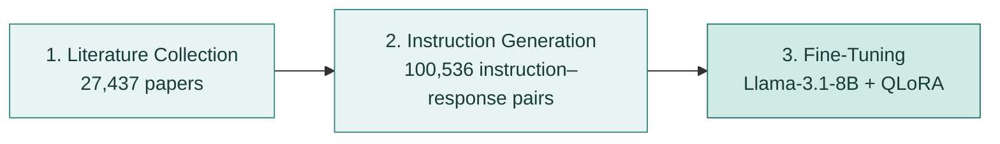

# Llama-3.1-TB

### An AI Research Assistant for Tuberculosis Scientists

 

*"A time when 'just google it' is no longer enough."*

— Gusenbauer, *The Age of Abundant Scholarly Information and Its Synthesis* (2021) [1]

---

Tuberculosis remains one of the deadliest infectious diseases worldwide. In 2023 alone, an estimated 10.8 million people developed TB, and 1.25 million died [2].

At the same time, TB is an extensively studied disease. More than **263,000 TB-related articles** were published between 1849 and 2020 [3], and output has kept rising each year [4]. This research spans epidemiology, fundamental research, diagnostics, treatment, vaccines, and public health [5].

Therefore, the problem isn't a lack of research but that relevant knowledge is scattered across thousands of papers and specialized resources [6], making it difficult to find, compare, and connect findings.

**This is the problem Llama-3.1-TB aims to address.**

 

## The solution: A research assistant built for TB

Llama-3.1-TB is an 8-billion-parameter language model fine-tuned on tuberculosis research literature.

Instead of working through papers one by one, researchers can ask questions in natural language and use the assistant to:

- **Interpret experimental results** and explore possible biological explanations.
- **Critically assess methods** and identify potential limitations.
- **Understand biological mechanisms** involving TB genes, proteins, and pathways.
- **Explore hypotheses** and possible directions for further experiments.

The aim is not to replace scientific judgment or literature review, but to make it easier to work through complex research questions.

 

## How it works

The model was developed in three main stages:

### 1. Literature collection

27,437 TB research papers were collected and processed into 489,423 text chunks (approximately 173 million tokens).

### 2. Instruction generation

TB experts at the Jinich Lab created 50 seed examples of realistic scientific questions and expert responses. Following the BioInstruct approach [9], these were used to guide Llama-3.3-70B in generating 100,536 literature-grounded instruction–response pairs, which formed the training dataset for fine-tuning.

### 3. Fine-tuning

Llama-3.1-8B-Instruct [7] was fine-tuned using QLoRA [8] to produce a TB-specialized model that can run locally on a single GPU.

I also explored continued pretraining [10, 12] and several retrieval-augmented generation (RAG) approaches [11, 13], including replications of published recipes, to compare different methods of domain adaptation.

 

## Evaluation: Does specialization improve performance?

The models were evaluated on **960 questions from 200 held-out TB research papers**, using an explanation-based multiple-choice benchmark.

### Model performance

```mermaid
---
config:
  themeVariables:
    xyChart:
      plotColorPalette: "#26867D, #5479B8"
---
xychart-beta
    title "Model Performance Comparison"
    x-axis ["Base Llama", "Llama-3.1-TB", "CPT + SFT", "SFT + RAG"]
    y-axis "Score (%)" 0 --> 100
    bar "Accuracy" [77.0, 80.6, 79.3, 71.6]
    bar "Penalized accuracy" [65.8, 71.0, 69.0, 57.5]
```

**Legend:** 🟩 **Accuracy** · 🟦 **Penalized accuracy**

Base Llama = Base Llama-3.1-8B; CPT = continued pretraining; SFT = supervised fine-tuning; RAG = retrieval-augmented generation.

### Key findings

Compared with the base model, **Llama-3.1-TB improved answer accuracy by 3.6 percentage points and penalized accuracy by 5.2 percentage points** (p = 0.0057 for penalized accuracy).

It also showed statistically significant improvements in factual accuracy, coherence, and naturalness in the generation style.

Interestingly, the simpler supervised fine-tuning approach performed better on this benchmark than the more complex methods I tested. Continued pretraining offered no clear additional benefit, while RAG reduced performance on the primary reasoning benchmark.

 

This project explores whether a relatively small, domain-specific language model can help researchers work with specialized scientific knowledge without requiring large-scale training or external inference APIs.

The results suggest that fine-tuning on literature-grounded scientific instructions can improve a general-purpose model's performance on TB-specific questions.

The longer-term goal is to develop a practical research tool that helps scientists make sense of existing findings and explore new questions.

 
### Model Availability

We are currently working toward the public release of Llama-3.1-TB. In the meantime, researchers interested in testing the model can clone this repository or contact me to request access.

## References

<strong>Scientific motivation</strong>

 

1. Gusenbauer M. The age of abundant scholarly information and its synthesis: A time when "just google it" is no longer enough. *Research Synthesis Methods*. 2021;12(6):684–691. https://doi.org/10.1002/jrsm.1520

2. Lee H, Kim J, Kim J, Park YJ. Review of the Global Burden of Tuberculosis in 2023: Insights from the WHO Global Tuberculosis Report 2024. *Public Health Weekly Report*. 2025;18(11 Suppl):S55–S69. https://doi.org/10.56786/PHWR.2025.18.11suppl.5

3. Ekenoğlu Merdan Y, Etiz P. A Scopus-Based Bibliometric Analysis of Global Tuberculosis Publications: 1849–2020. *Turkish Thoracic Journal*. 2022;23(3):246–256. https://doi.org/10.5152/TurkThoracJ.2022.21284

4. Kshtriya P, Prajapati A, Chakraborty M, Ganguly P. Global Tuberculosis Research Landscape: A Comprehensive Bibliometric Analysis of PubMed Literature (2017–2024). *The International Information & Library Review*. 2026;58(2):175–195. https://doi.org/10.1080/10572317.2026.2631197

5. Nafade V, Nash M, Huddart S, Pande T, Gebreselassie N, Lienhardt C, et al. A bibliometric analysis of tuberculosis research, 2007–2016. *PLoS ONE*. 2018;13(6):e0199706. https://doi.org/10.1371/journal.pone.0199706

6. Jinich A, Zaveri A, DeJesus MA, Spencer A, Almada-Monter R, Flores-Bautista E, et al. The *Mycobacterium tuberculosis* Transposon Sequencing Database (MtbTnDB): A Large-Scale Guide to Genetic Conditional Essentiality. *Molecular Microbiology*. 2025;124(1):91–101. https://doi.org/10.1111/mmi.15370

<strong>Methods and related work</strong>

 

7. Grattafiori A, Dubey A, Jauhri A, et al. The Llama 3 Herd of Models. 2024. https://arxiv.org/abs/2407.21783

8. Dettmers T, Pagnoni A, Holtzman A, Zettlemoyer L. QLoRA: Efficient Finetuning of Quantized LLMs. *Advances in Neural Information Processing Systems*. 2023;36:10088–10115.

9. Tran H, Yang Z, Yao Z, Yu H. BioInstruct: Instruction Tuning of Large Language Models for Biomedical Natural Language Processing. 2024. https://arxiv.org/abs/2310.19975

10. Labrak Y, Bazoge A, Morin E, Gourraud PA, Rouvier M, Dufour R. BioMistral: A Collection of Open-Source Pretrained Large Language Models for Medical Domains. *Findings of the Association for Computational Linguistics: ACL 2024*. 2024:5848–5864. https://doi.org/10.18653/v1/2024.findings-acl.348

11. Hashemi SMH, Kashani HB, Fatemi S. MediMind: A Domain-Adaptive Medical LLM Leveraging Fine-Tuning and Retrieval-Augmented Generation. *2025 9th International Conference on Internet of Things and Applications (IoT)*. 2025:1–6. https://doi.org/10.1109/IoT69654.2025.11297589

12. Doll N, Buschhoff JS, Satheesh S, Abdelwahab H, Allende-Cid H, Klug K. Can Continual Pre-training Bridge the Performance Gap between General-purpose and Specialized Language Models in the Medical Domain? 2026. https://arxiv.org/abs/2604.19394

13. Bal DP, Puhan S. Benchmarking Retrieval Strategies for Biomedical Retrieval-Augmented Generation: A Controlled Empirical Study. 2026. https://arxiv.org/abs/2605.02520

 

---

**Seda Kavlak**

M.Sc. Bioinformatics, University of Potsdam

Research conducted at the Jinich Lab, UC San Diego, advised by Prof. Adrian Jinich.

