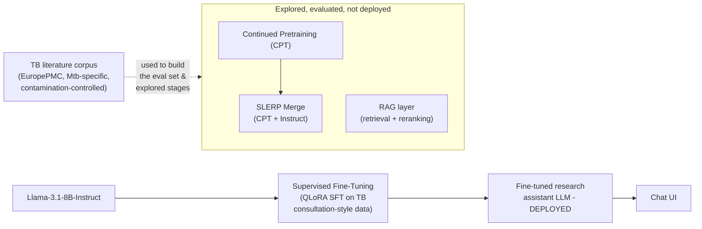

# TB Research Assistant

**One of the first LLMs built specifically for tuberculosis research** — not a general medical
chatbot with TB facts bolted on, but a model fine-tuned end-to-end on TB/*Mycobacterium
tuberculosis* science to think *with* researchers, not just answer at them.

Every published domain-adapted biomedical LLM this project was benchmarked against (BioMistral,
DeFineMed, BioInstruct, MediMind) targets general biomedicine. This one doesn't — it's built to
sit next to a TB researcher and do the parts of the job that take real scientific reasoning:
reading an experimental result and saying what it actually means, pressure-testing a methodology
before it goes any further, and helping prioritize what to try next — grounded in the TB
literature itself, not generic medical trivia.

This is a curated showcase of the project for people outside the lab. The full research
repo (every experiment, every SLURM script, every intermediate result) lives at
[sedak326/tuberculosis_agent](https://github.com/sedak326/tuberculosis_agent).

## Try it

<!-- Live demo link: ask me and I'll have it running within a few minutes - it runs on a
     shared university GPU cluster, not kept on 24/7, so I spin it up on request rather than
     leave a link here that silently goes stale. -->
<!-- TODO: record a short demo (asking it a factual question, a methodology critique, and a
     hypothesis-generation prompt) and add it here:  -->

Want to try the live model? Reach out and I'll send you a link.

## What it can do

The deployed model is `Llama-3.1-8B-Instruct` fine-tuned with QLoRA on TB-specific instruction
data — no continued pretraining and no retrieval in the final pipeline (both were built and
evaluated, see below, but a straightforward fine-tune on the Instruct base turned out to beat
both in evaluation, so that's what's actually running).

- **Reasons through TB research problems**, not just factual lookups: interpreting what an
  experimental result actually means, critiquing a methodology before it goes further, prioritizing
  a target, or generating a testable hypothesis.
- **Answers TB-specific research questions** using TB knowledge and interaction style learned
  during fine-tuning on TB consultation-style instruction data.
- **Runs as a real, self-hosted chat app** (`chat_ui.py`) — no external LLM API in the loop for
  generation, served from a single GPU.

Example:

> **Q: What is ESAT-6?**
>
> ESAT-6, or Early Secreted Antigen 6, is a protein secreted by *Mycobacterium tuberculosis*, a
> bacterium that causes tuberculosis. It is a key virulence factor, meaning it plays a crucial
> role in the pathogenesis of TB. ESAT-6 is involved in the evasion of the host immune response,
> allowing the bacteria to survive and replicate within the host. It is secreted by the ESX-1
> secretion system, a type VII secretion system essential for the virulence of *M. tuberculosis*...

## How it's built

The deployed model is just the last step below — fine-tuning directly on the Instruct base. The
earlier stages (continued pretraining, merging, retrieval) were built and evaluated as candidates
for improving on that, not skipped out of laziness: each was run head-to-head against plain
fine-tuning on the same held-out evaluation set, and plain fine-tuning won, so it's what's deployed.

1. **Corpus construction** — TB/Mtb-specific research literature fetched from EuropePMC, restricted
   to papers that genuinely discuss TB in the title/abstract. Contamination-controlled: built only
   from papers published after the base model's pretraining cutoff, so continued pretraining can't
   re-expose the model to memorized text, and the held-out evaluation set is guaranteed unseen. Used
   both to build the fine-tuning data and as the corpus for the RAG experiments below.
2. **Supervised fine-tuning (QLoRA SFT)** — fine-tuning `Llama-3.1-8B-Instruct` directly on
   TB-specific instruction data (consultation-style Q&A, methodology critique, hypothesis
   generation, result interpretation). **This is the deployed model.**
3. *Explored, evaluated, not deployed:* **continued pretraining (CPT)** on the TB corpus before
   fine-tuning, including replications of two published domain-adaptation setups (Doll et al.
   2026's DeFineMed, Labrak et al. 2024's BioMistral), each followed by a **SLERP merge** back
   into the Instruct model to recover instruction-following lost during CPT. None beat plain
   fine-tuning on the evaluation set.
4. *Explored, evaluated, not deployed:* **retrieval-augmented generation (RAG)** — three retrieval
   backends were built and compared, grounding answers in retrieved corpus passages at query time
   instead of relying purely on the fine-tuned model's own knowledge. Only one of the three showed
   a measurable improvement over the plain fine-tuned model, and it's not currently wired into the
   deployed chat app.

## What's in `core/`

A representative sample from each pipeline stage (the full set of experiment scripts, SLURM job
configs, and ablations live in the [full repo](https://github.com/sedak326/tuberculosis_agent)):

| File | Stage |
|---|---|
| `train_cpt.py` | Continued pretraining (QLoRA) |
| `train_sft.py` | Supervised fine-tuning (QLoRA) |
| `merge_configs/v5_cpt_instruct_slerp.yaml` | SLERP merge recipe |
| `rag_pipeline.py` | Retrieval + generation pipeline |
| `chat_ui.py` | Self-hosted chat UI (Flask) serving the fine-tuned model |
| `evaluate_emcqa.py` | Evaluation: inference over the held-out MCQ set |
| `generate_mcq.py` | Builds the held-out multiple-choice evaluation set |

## Stack

Llama-3.1-8B-Instruct / Qwen2.5-7B-Instruct base models · QLoRA (PEFT + bitsandbytes) · `mergekit`
(SLERP) · LangChain + Chroma (RAG) · sentence-transformers / PubMedBERT embeddings · Flask ·
GPT-4o as an automated judge for explanation quality · SLURM for cluster scheduling.

## Author

**Seda Kavlak** — Jinich Lab, UC San Diego. Advised by Prof. Jinich.
